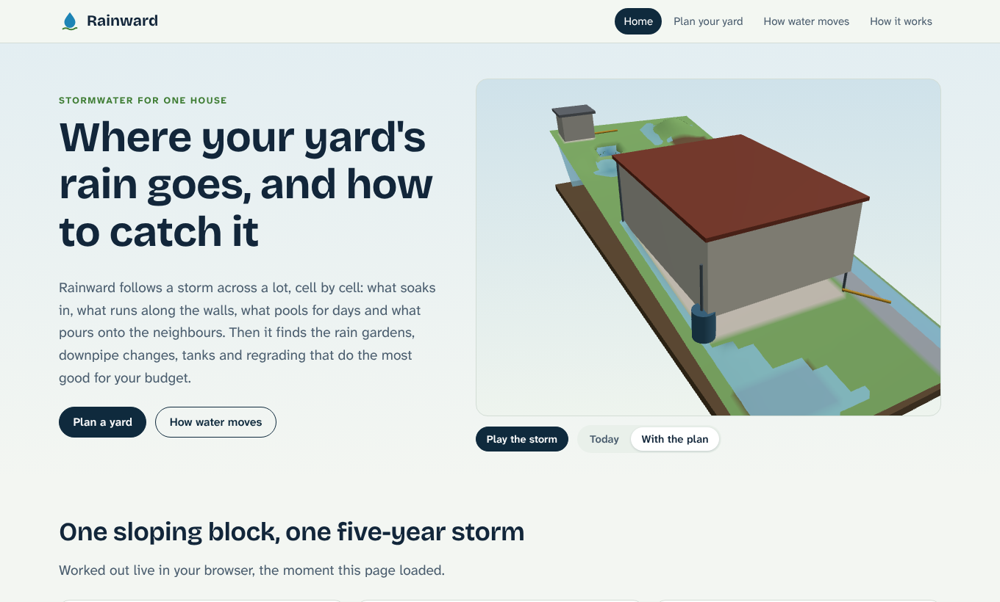
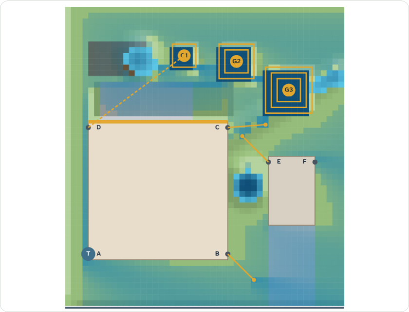
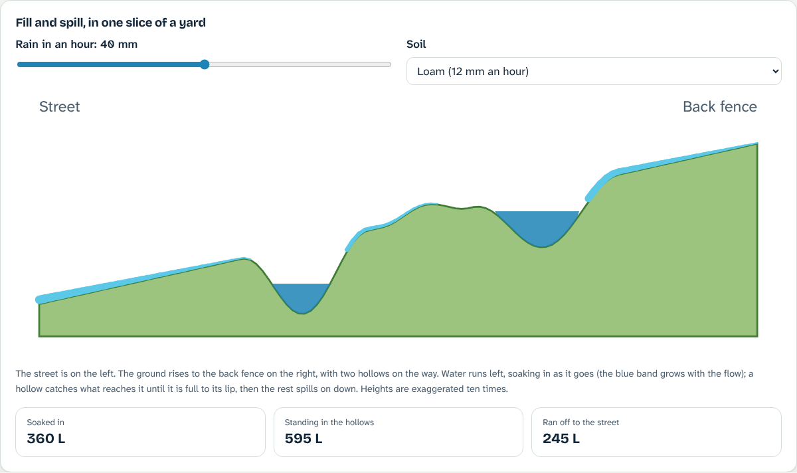
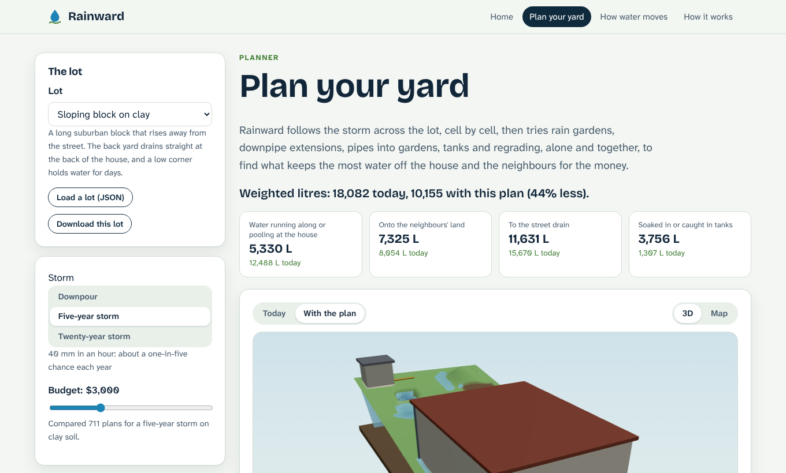
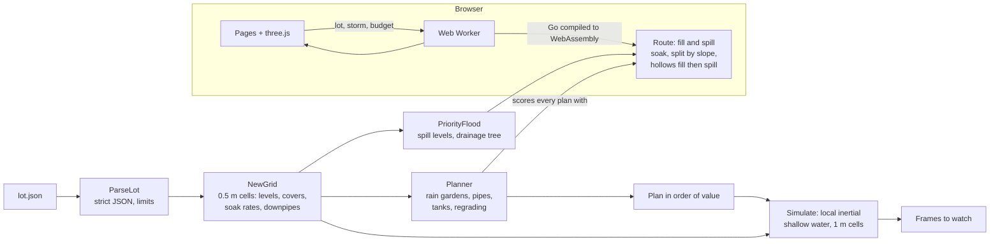

# Rainward

**Follow a storm across your yard, then catch it where it counts.**

[](https://github.com/reihooneh/rainward/actions/workflows/ci.yml)


**Live:** https://reihooneh.github.io/rainward/

Rainward works on a home's lot cell by cell, half a metre at a time. For a design storm it works out:
- what soaks in;
- what runs along the house walls;
- what pools against the house or lingers on the lawn for days;
- what pours onto the neighbours' land or into the street.

Then it searches the changes a homeowner can actually make (rain gardens, downpipe extensions, pipes into gardens, rain tanks and regrading) and finds the plan that keeps the most water off the house and the neighbours within a budget, in the order to do it.



## Why I built this

Water against a house's footings is behind a lot of damp walls, cracked slabs and sinking paths, and most fixes are cheap if they're in the right place. The tools I could find size a rain garden from a roof area, or estimate a site's total runoff with no map at all. None of them shows where the water goes on your own block. So none can tell you that the downpipe at the back corner is the one to fix, or that a garden on the far side of the lawn will catch nothing.

Rainward turns that into something you can see, measure and plan. It uses the same algorithms hydrologists use for whole catchments and flood engineers use for cities, sized down to one yard and run in a browser.

## Features

- **Two water models, checked against each other:**
  - **Fill and spill**, for planning (about a millisecond per plan). A priority flood finds every hollow and where it overflows. Water then passes downhill once: soaking in at the soil's rate, splitting among lower neighbours by slope, and filling hollows before they spill.
  - **The storm, second by second**, for watching. The local-inertial shallow-water equations used in flood modelling, with Manning friction, a Courant time step and a positivity limiter. Every litre is accounted for.
  - The tests check the two agree on how much water leaves the lot (within 8%).
- **A planner for the money.** It weighs:
  - rain gardens (2 to 4 m square, dug 15 cm with a berm, at least 3 m from the house, in the flow paths);
  - downpipe extensions in three directions;
  - buried pipes into gardens (only where a pipe can fall 1 in 100);
  - 2,000 or 5,000 L tanks;
  - regrading a side of the house so the ground falls 15 cm over 3 m.

  Changes interact, so it scores whole plans. It grows them greedily three ways (avoiding the knapsack trap of cheap small wins), then swaps parts until nothing improves. On 40 small random lots it found the plan an exhaustive search found on 39, and came within 1% on the other.
- **Watch the storm in 3D:** sheets of water crossing the lawn, pools rising and draining, rain falling while it lasts, today and with the plan.
- **A map from above:** where water ran (darker for more), where it pooled, and every change in the plan, labelled.
- **An interactive explainer:** fill and spill on a slice of yard, with rain and soil you control.
- **Your own lot:** load a JSON description, or download an example and edit it.

| The plan, from above | Fill and spill, explained |
|---|---|
|  |  |



## Architecture



## Sample output (command line)

```text
$ go run ./cmd/rainward lots/clay-slope.json
Rainward: Sloping block on clay
40 mm in an hour: about a one-in-five chance each year, clay soil, budget $3000

                                            today    with plan
  rain and roof water                    25,640 L     25,640 L
  caught in tanks                             0 L      1,480 L
  soaked in during the storm              1,307 L      2,276 L
  left standing in hollows                  609 L      2,928 L
  ran to the street                      15,670 L     11,631 L
  ran onto neighbours' land               8,054 L      7,325 L
  ran along the house walls              12,488 L      5,330 L
  pooled against the house                    0 L          0 L
  pooled for more than a day                  0 L          0 L

  score (weighted litres, lower is better): 18082 → 10155 (44% less)

The plan ($2920), best value first:
  1. Extend downpipe A 3 m away from the house                    $  125   score  16691
  2. Extend downpipe C 3 m away from the house                    $  125   score  15458
  3. Dig a 2 × 2 m rain garden (G1)                               $  340   score  14393
  4. Dig a 2 × 2 m rain garden (G2)                               $  340   score  13338
  5. Make rain garden G1 3 × 3 m                                  $  425   score  12147
  6. Fit a 2,000 L rain tank to downpipe B                        $ 1100   score  10519
  7. Dig a 2 × 2 m rain garden (G3)                               $  340   score  10189
  8. Extend downpipe E 3 m away from the building                 $  125   score  10155
```

The two $125 extensions do the most per dollar, which is typical: water dumped at the foot of a wall is the cheapest problem to fix.

## Stack

- **Engine:** Go (standard library only), compiled to WebAssembly (`GOOS=js`). It runs in a Web Worker, so the page never freezes.
- **Site:** plain ES modules and three.js 0.186 (self-hosted). Fonts are Bricolage Grotesque and Atkinson Hyperlegible Next, also self-hosted. There's a strict CSP and no framework.
- **Tests:** Go's `testing` (with a fuzz target), and Playwright 1.63 at phone, tablet and desktop sizes.
- **CI:** GitHub Actions does lint, tests, the race detector, fuzzing, a byte-for-byte rebuild of the WebAssembly and site, browser tests and an audit, then deploys to GitHub Pages.

## Run it

```bash
# Engine and command line (Go 1.24)
make test                                   # engine and command-line tests
go run ./cmd/rainward lots/corner-loam.json # a plan in the terminal
go run ./cmd/rainward -storm twenty-year -budget 6000 -json lots/sandy-flat.json

# Site
npm ci
make wasm && npm run build                  # Go → WebAssembly, then the pages
npm run serve                               # http://127.0.0.1:4173/
npx playwright install chromium && npm test # every page at three sizes
```

## Tests

- **Every drop accounted for:** rain plus roof equals tanks, soaked, ponded, street and neighbours, to 1e-9, in both models, on the examples and dozens of random lots.
- **Known answers:** a bowl holds the volume geometry says (πr²h(½ − 2/π²) for a raised-cosine dip), and a big storm fills it exactly to its lip. More rain makes more runoff, and sand sheds less than loam, which sheds less than clay.
- **The flood tree:** every cell is reached, drains to an edge, never uphill, never out of order.
- **Both models agree** on how much water leaves each example lot.
- **The planner:**
  - it stays in budget and never makes things worse;
  - rain gardens stay 3 m from the house and off paving, pipes never run uphill, and a dug garden really holds its volume;
  - it matches exhaustive search on small lots;
  - the largest possible lot plans in bounded time.
- **Hostile input:** malformed, oversized and prototype-polluting lots, markup in names, and fuzzing of the parser. The command line refuses links and folders.
- **The site:** no console errors, no sideways scrolling, and no overlapping text, controls or SVG on any page at any size. It is tested end to end: storms, budget, views, the time slider, downloading, hostile uploads, the explainer, the server's path checks and every page's CSP.

## Security

See [SECURITY.md](SECURITY.md). In short:

- **Static site:** everything runs in the browser, and lots never leave your device.
- **Strict CSP:** no inline code, and nothing from other sites.
- **No HTML from strings:** the pages are built with DOM calls only, and a test enforces it.
- **Untrusted lots:** they are size-capped, prototype keys are refused, then the Go engine decodes them strictly (no unknown fields, ranges on everything) and never echoes them.
- **The worker:** it validates every message.
- **Bounded work:** the planner has a work limit, so even the largest lot can't hang the tab.
- **Dependencies:** they are pinned and audited, and the WebAssembly is reproducible.

## Limits and roadmap

**Limits:**
- Soil rates are steady averages, and real ones vary across a yard.
- Storms are spread evenly through the hour.
- Ground shape comes from a few features, not a survey.
- Pits, pipes and fences that steer water aren't modelled.
- Prices are rough.

Anything that drains near footings, connects to the street drain or changes where water leaves the property may need council approval and a licensed plumber.

**Roadmap:**
- **Draw your own lot:** sketch the house, paving and slopes on the map instead of writing JSON.
- **Measured ground:** import a phone LiDAR scan or a council contour file for real levels.
- **Real storms:** design rainfall for your postcode (Bureau of Meteorology intensity-frequency-duration data), with bursts inside the hour.
- **Soil test helper:** turn a backyard hole test into your yard's own soaking rate.

More detail: [HOW-IT-WORKS.md](HOW-IT-WORKS.md).

## Licence

MIT. three.js (MIT), Go's `wasm_exec.js` (BSD), and the fonts (SIL OFL) are vendored with their licences.
